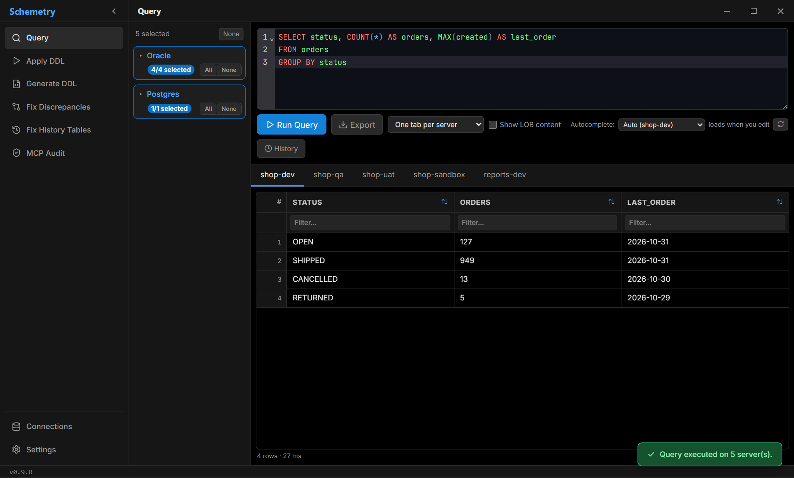
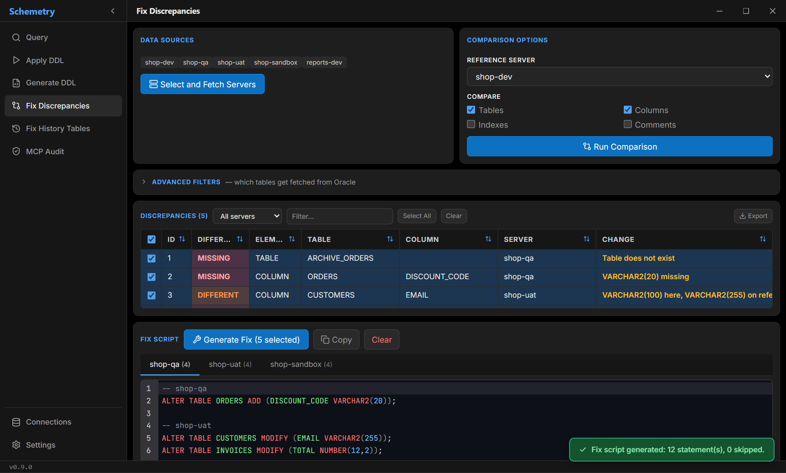
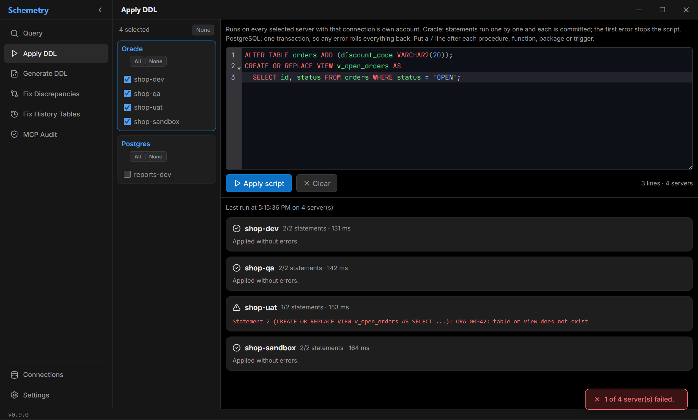
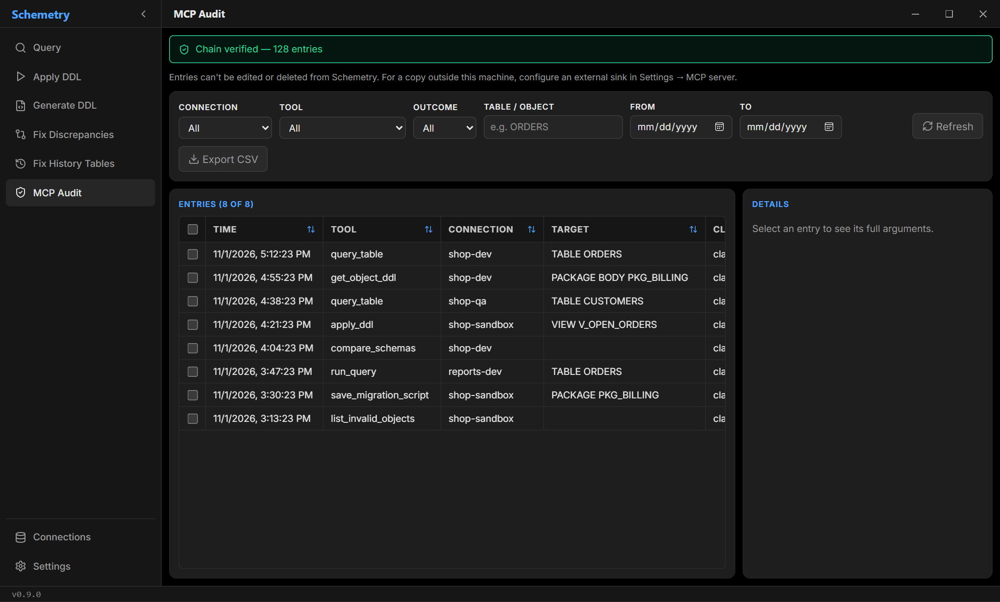
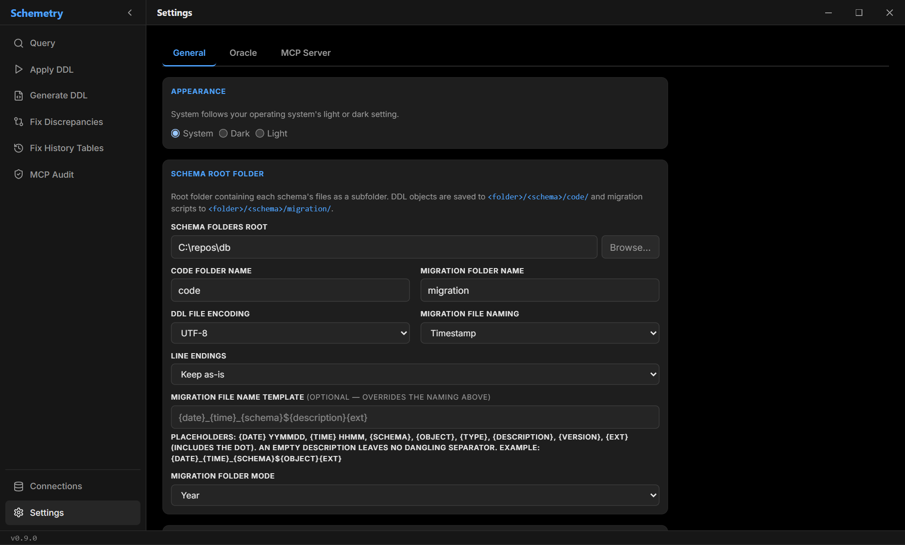
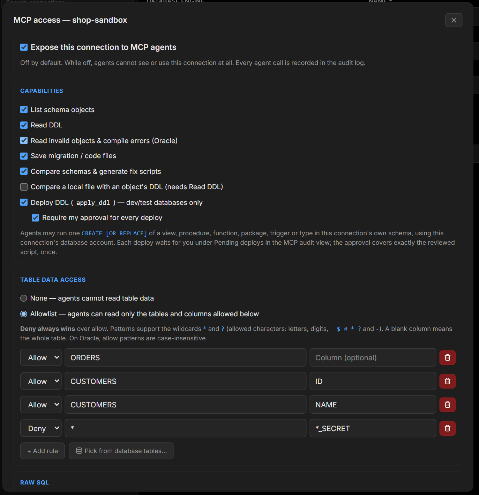

# Schemetry

[](https://github.com/A1nar-S/schemetry/actions/workflows/ci.yml)
[](https://github.com/A1nar-S/schemetry/actions/workflows/security.yml)
[](https://codecov.io/gh/A1nar-S/schemetry)
[](https://github.com/A1nar-S/schemetry/releases/latest)
[](LICENSE)

[](https://tauri.app)

Desktop database tooling: schema comparison, DDL generation, SQL querying, and fix script generation. Currently supports Oracle and PostgreSQL.



## Purpose

Built for multitenant setups where each tenant runs on its own database (server) rather than a shared schema. Schemetry lets you query and compare those per-tenant databases against each other to spot drift, and generate idempotent fix scripts to bring them back in sync. Each connection is either Oracle or PostgreSQL; schema comparison and fix generation only run across connections of the same engine.

## Features

- **Query** one or more servers at once and export results to XLSX. LOBs open in a built-in viewer.
- **Fix Discrepancies**: compare servers against a reference and generate idempotent fix scripts.
- **Apply DDL**: run a script on selected servers, with a confirmation prompt and per-server results.
- **Generate DDL**: save source files or versioned migrations with configurable naming, encoding and line endings.
- **MCP server**: lets AI agents work with your databases under default-deny policies and a tamper-evident audit log. See [docs/MCP.md](docs/MCP.md).
- Passwords are kept in the OS keychain. Dark, light or system theme.

| Fix Discrepancies | Apply DDL |
|---|---|
|  |  |

| MCP Audit | Settings |
|---|---|
|  |  |

Per-connection MCP permissions. Agents get nothing until you enable it:



## Getting started

Download the installer from the [latest release](https://github.com/A1nar-S/schemetry/releases/latest), or run from source.

Requirements: [Rust](https://rustup.rs/), Node.js 18+, the Tauri CLI (`cargo install tauri-cli`), and Oracle Instant Client if you connect to Oracle (set its path in Settings).

```powershell
npm install
npm run tauri dev
```

## Development

```powershell
npm run check                              # TypeScript / Svelte
npm run lint                               # ESLint
cargo test --workspace                     # Rust unit tests
npm run tauri build                        # desktop build
cargo build --release -p schemetry-mcp     # MCP server only
```

| Crate | Path | Purpose |
|---|---|---|
| `schemetry-core` | [core/](core) | Models, repositories, services, MCP gateway. No GUI dependencies. |
| `schemetry` | [src-tauri/](src-tauri) | The Tauri desktop app. |
| `schemetry-mcp` | [mcp/](mcp) | The stdio MCP server. |

Stack: Svelte 5, TypeScript, Tauri v2, Rust, SQLite, `oracle` (OCI) and `tokio-postgres`.

<details>
<summary>Integration tests (Docker)</summary>

Two Oracle and two PostgreSQL containers are started and migrated with Flyway. The tests are `#[ignore]`d, so plain `cargo test` never needs Docker.

```powershell
cd docker
docker compose up -d --build
docker compose ps     # wait until every service is healthy
cd ..

# set ORACLE_CLIENT_LIB_DIR if Instant Client is not on PATH
cargo test -p schemetry-core --test oracle_integration -- --ignored
cargo test -p schemetry-core --test postgres_integration -- --ignored
cargo test -p schemetry-core --test mcp_integration -- --ignored

cd docker
docker compose down -v
```

</details>

## License

MIT, see [LICENSE](LICENSE).
